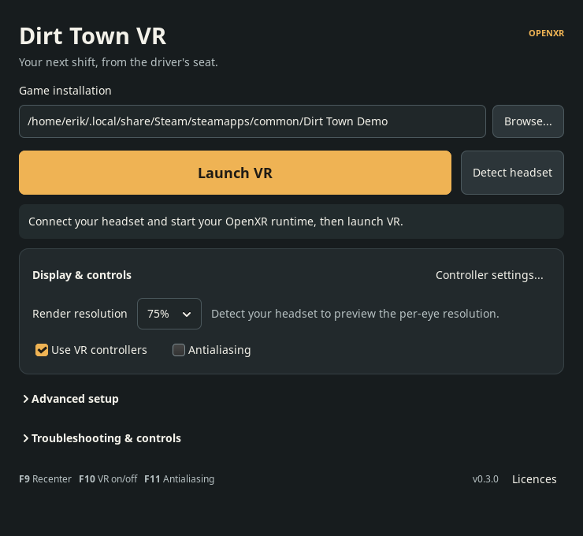

Dirt Town VR Mod
================

Play **Dirt Town Demo** in VR with OpenXR stereo, head tracking and VR
controllers. Game files and saves are not modified.

Run
---

You need Dirt Town Demo, a headset and a PC OpenXR runtime. Supported platforms
are Windows x64 and Linux x86-64. Linux also needs Steam, Proton with OpenXR
support, GTK 3 and the native OpenXR loader. No Python installation is needed.

1. Download and extract the package for your platform from `Releases
   <https://github.com/ecke101/dirttown-vr-mod/releases>`_.
2. Connect your headset and start your OpenXR runtime. Close Dirt Town if it
   is already running.
3. Run ``dirttown-vr.exe`` on Windows or ``./dirttown-vr`` on Linux. Select
   the game folder if it is not detected.
4. Click **Detect headset**, choose a render resolution, then **Launch VR**.
   Start at **50–75%** if performance is poor.
5. Load a site on your monitor to enter VR. **Menus and HUD stay on the monitor.**

The launcher remembers your preferences.

Key controls
------------

* **F9**: recenter. **F10**: toggle VR. **F11**: toggle antialiasing
  (off by default).
* **Left stick**: move, drive and steer. **Right stick**: look while walking;
  control the blade or bucket in a dozer or loader.
* **Y / left secondary**: enter or exit. **X / left primary**: interact.
  **B / right secondary**: toggle grade hold.
* **Right-stick click**: change camera. **Both stick clicks**: pause/menu.

Use **Controller settings...** to edit bindings, then restart the game.
See the `full controls and reference <docs/reference.rst>`_ for dozer blade
adjustments, controller profiles and eye-distance shortcuts.

Compatibility and troubleshooting
---------------------------------

* Supports **Dirt Town Demo**, Steam app **5471710**, builds **26658761** and
  **26690600**.
* Tested with **Pico 4 through WiVRn/Proton on Linux**. Windows runtimes and
  other headset/controller combinations still need physical testing.
* The game and VR runtime must use the **same GPU**. Leave the graphics backend
  on **Automatic** to start; the D3D11 fallback is experimental.
* Open **Troubleshooting & controls** in the launcher to **Test headset**,
  **Test graphics** or **Open logs**.

For command-line options, runtime overrides, log locations and building from
source, see the `reference <docs/reference.rst>`_.
